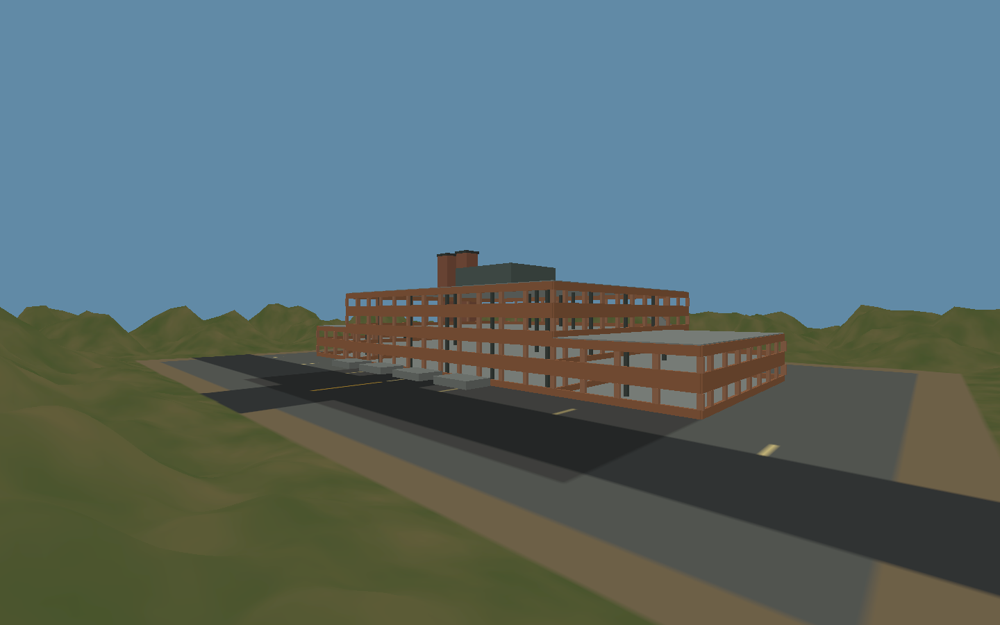
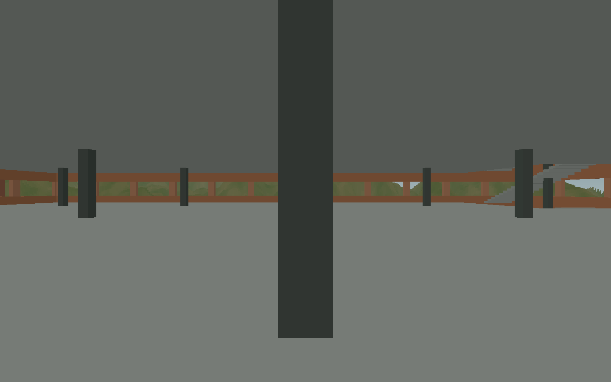
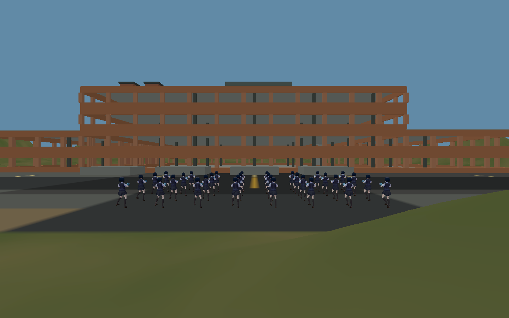

# CQ terrain and factory rendering experiment

LOD heightfield patches with separate factory geometry are the strongest candidate from this experiment. On the Intel N95 GPU, the front map view costs 2.09 ms per frame, 31% below the full heightfield mesh. Full-resolution classic VoxelSpace columns are slower. With 32 animated bundled avatars and springs disabled, the LOD cases still exceed the 60 FPS frame budget at p95. Terrain savings alone do not establish the 32-player district goal.

The experiment is isolated in `experimental/cq-voxelspace`, worktree `Godot-voxelspace`, based on the filtered upstream integration `9a3e9c8`. It does not replace the production BSP maps or change district admission limits.

## OpenNova reference and rendering choices

OpenNova at `a092ba28f3c7a729520f4d5014cfd6f5fed348b5` uses heightfield terrain mesh families and a patch draw list. Its Godot renderer instantiates ordinary 3D geometry for those patches. This informed the original four-family terrain implementation here; OpenNova was inspected as a reference, not ported or benchmarked. [Terrain implementation](https://github.com/opennova-net/opennova/blob/a092ba28f3c7a729520f4d5014cfd6f5fed348b5/godot/src/terrain/terrain.cpp), [terrain frame layout](https://github.com/opennova-net/opennova/blob/a092ba28f3c7a729520f4d5014cfd6f5fed348b5/engine/runtime/terrain/terrain_frame.h).

Classic VoxelSpace projects height samples into vertical screen strips, progressing from near to far with a skyline limit. One height per horizontal coordinate cannot represent stacked rooms or an overhang. The solid-factory case therefore produces factory mass with painted window bands. The hybrid case renders terrain columns into color and linear-depth textures, then composites real factory polygons using projected depth. [Classic algorithm reference](https://github.com/s-macke/VoxelSpace).

The GPU prototype dispatches one compute invocation per screen column on Godot's main RenderingDevice. It avoids per-frame CPU image readback and explicit device synchronization. Both compute and resource cleanup run through `RenderingServer.call_on_render_thread`. [Godot compute shaders](https://docs.godotengine.org/en/stable/tutorials/shaders/compute_shaders.html), [RenderingServer API](https://docs.godotengine.org/en/stable/classes/class_renderingserver.html).

## Generated factory and terrain

The original synthetic map spans 250 × 250 metres with 513 × 513 height samples, deterministic noise seed 1977, hills, a flattened yard, access road and painted parking areas. A four-storey factory has two lower annexes, rooftop machinery, chimneys, loading platforms, open window bays, separate floor slabs and three stair flights. Its 445 boxes are batched into one 5,340-triangle surface. All terrain and factory materials use unshaded colors; yard shadow colors are baked into the generated colormap.

The full terrain has 524,288 triangles. The front LOD view uses 62,336 terrain triangles across 44 visible patches, batched into four MultiMeshes. Patch mesh and instance bounds include the displaced terrain heights. Mesh skirts conceal differences between adjacent resolution families; interpolation is disabled for the static patch transforms.





## Rendering measurements

Godot 4.7.2-stable (official), Vulkan Mobile, Intel N95 / Intel ADL-N integrated GPU, 1440 × 900 desktop window, no MSAA, vsync off and no frame cap. Each case has 120 warmup frames and 360 timed frames. Screenshots occur outside the timed interval. The 31 cases total 11,160 sampled frames. Source hashes, setup times, counters, p99 values and separate compute timings are in [the measurement receipt](validation/cq-voxel-factory-rendering.json).

| Case | Median frame ms | p95 frame ms | Viewport GPU median ms |
| --- | ---: | ---: | ---: |
| Full heightfield mesh plus factory | 3.02 | 5.65 | 2.25 |
| LOD terrain patches plus factory | 2.09 | 4.19 | 1.30 |
| Classic columns including solid factory mass | 3.81 | 6.21 | 1.64 |
| Classic columns plus polygon factory | 3.87 | 6.45 | 1.78 |
| Classic hybrid terrain at 720 × 450 | 2.76 | 5.19 | 1.56 |
| Classic hybrid terrain at 360 × 225 | 2.60 | 4.71 | 1.50 |

Static front comparisons repeated in reverse order: LOD patches 2.03 ms, full mesh 3.10 ms, classic hybrid 4.09 ms. Lowering column resolution reduces compute cost but still does not beat the full-resolution LOD terrain in this view; it also introduces coarser terrain and depth edges. Factory polygons retain the full window resolution.

| Case | Median frame ms | p95 frame ms | Viewport GPU median ms |
| --- | ---: | ---: | ---: |
| Full mesh moving camera | 3.23 | 5.36 | 2.37 |
| LOD patches moving camera | 2.31 | 4.09 | 1.33 |
| Classic hybrid moving camera | 4.10 | 6.48 | 1.82 |
| LOD patches inside second storey | 2.50 | 4.64 | 1.70 |
| Classic hybrid inside second storey | 4.75 | 7.13 | 2.37 |

Viewport GPU times exclude the separately bracketed column dispatch. Custom dispatch medians are approximately 1.3 ms at full resolution. Wall-clock frame times are the primary comparison; adding percentile values from separate GPU measurements does not produce a whole-frame latency percentile. Vulkan timestamp results are converted from nanoseconds to milliseconds, consistent with [Godot's Vulkan driver](https://github.com/godotengine/godot/blob/master/drivers/vulkan/rendering_device_driver_vulkan.cpp).

## The 32-player target

Each avatar case places 32 shared copies of one bundled VRM in four rows, 12–18 metres from the camera. Rigs animate at running speed with production distance LOD, spring motion disabled and one unshadowed directional light. The same locally built native extension from the filtered districts integration is loaded for every renderer. This isolates renderer alternatives under a substantial client avatar load without implying unique-avatar or network capacity certification.

| Model with 32 animated rigs | Full mesh median / p95 ms | LOD patches median / p95 ms | Classic hybrid median / p95 ms | LOD frames over 16.67 ms |
| --- | ---: | ---: | ---: | ---: |
| Bundled D | 12.96 / 19.44 | 14.46 / 23.32 | 18.23 / 30.76 | 42.2% |
| Bundled F | 14.96 / 25.16 | 13.09 / 23.34 | 14.24 / 21.14 | 39.2% |
| Bundled G | 13.08 / 20.25 | 13.13 / 20.04 | 13.85 / 20.45 | 34.2% |

Wall-clock variation makes small renderer differences under avatar load unreliable; the full mesh even wins the D median in this sequence. The consistent result is that all nine 32-rig cases miss the 16.67 ms budget at p95. LOD map-only cost at the same avatar camera is 2.11 ms, compared with 13–14.5 ms with the rigs. Avatar rendering and animation remain the main performance priority after native spring improvements. The earlier spring and upstream integration analysis is in [CQ district performance](CQ-DISTRICT-PERFORMANCE.md).



## Validation and practical limits

The final graphical run exited successfully without script errors, renderer errors, interpolation warnings or shutdown leaks. [65 geometry checks](validation/cq-voxel-factory-geometry.json) verify separate floor surfaces, facade walls, open windows, stair steps and slab openings. [Six image checks](validation/cq-voxel-factory-image-checks.json) verify column image orientation, matching visible opaque factory pixels in front, diagonal and interior views, and no foreground sky holes from displaced LOD culling.

These checks validate generated triangle geometry and rendering. Gameplay collision, district streaming, terrain edits, multiplayer traversal and audio occlusion are not integrated. The classic renderer currently supports yaw-only cameras, a 250-metre march and one terrain height per horizontal sample; pitch, roll and XR would require further renderer work. The raster camera far plane is 300 metres. No headset was tested.

The final BSP district 40 case uses different content, shading and sky settings. Its timing is context only and does not establish a speedup from converting that map to terrain. The factory has deliberately simple materials; production lighting and art may change the costs substantially.

For an outdoor district experiment, continue with LOD heightfield terrain and polygon buildings, then add collision and streaming before testing a representative district. Keep classic columns as a comparison prototype rather than treating their low triangle count as proof of lower frame time.

## Run the experiment

From `Godot-voxelspace`:

```bash
./launch-voxel-factory.sh
./launch-voxel-factory.sh --benchmark
"$HOME/.local/bin/Godot_v4.7.2-stable_linux.x86_64" --xr-mode off --headless --path . --script tools/voxelspace/validate.gd
python3 tools/voxelspace/validate_rendering.py
```

Set `GODOT_BIN` if the engine is installed elsewhere. Image checks require Pillow 12.1 or later. Interactive controls: WASD movement, Q/E height, hold right mouse to turn, keys 1 full mesh, 2 LOD terrain, 3 solid classic columns, 4 hybrid columns, Escape to exit. The map generator writes the height EXR, colormap PNG, geometry metadata and benchmark captures into ignored `test-results/voxelspace`.
