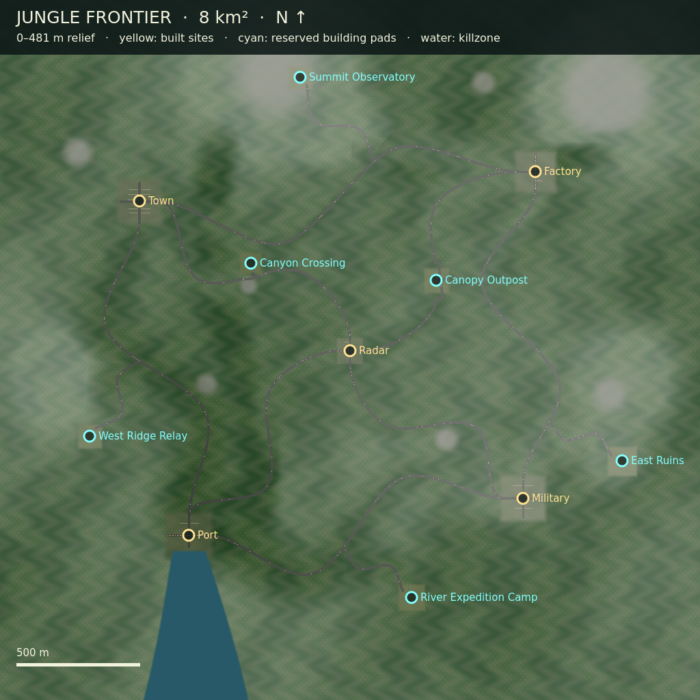

# Jungle Frontier: 8 km²

`experimental/cq-voxelspace` now uses a 2,828.427124746 m square (8,000,000 m²),
with sampled terrain elevations of 0–481.10 m. The five existing 170 cm human-scale
structure sets remain: town, factory, port, military compound and radar base.
They are spread over the new world. Two eroded canyon systems, rolling hills,
five mountain massifs and six exposed rock formations are evaluated by the
existing deterministic height/color terrain source. Rock instances have been
removed: environment species are broadleaf trees, palms and fern understory.

Roads and shoulders are graded and painted into the terrain atlas. POI
connectors follow curved intermediate waypoints and enter compound gates with
aligned tangents. A three-metre shoulder and broad terrain cut/fill transition
replace the old five-metre ridge blend: transitions are 28–220 m from the
centreline, increasing with the difference between road and natural elevation.
This creates supporting embankments rather than narrow elevated strips, without
extra road meshes or draws. Routes skirt reserved pads; access lanes still stop
at road shoulders. The boundary walls lie outside the ±1,414.214 m map limits.
The port estuary continues to the south edge and retains its authoritative
water killzone. This remains the original heightfield terrain pipeline; rock
ridges are terrain relief, with no separate rock draws, overhangs or cave meshes.

## Preview and reserved sites

```bash
./launch-jungle-preview.sh
```

RMB looks; WASD moves; Q/E moves vertically; Shift accelerates; L toggles site
labels. The dropdowns select foliage mode and jump to all five existing sites,
six reserved sites, three standing viewpoints and a prone-height canopy view.
Hybrid trees are the default. The undergrowth checkbox enables/disables the
constrained ground-cover experiment without changing tree mode. The preview has no AI,
avatars or collision simulation. The existing match launcher loads full-world
collision and navigation independently of the observer render cache.

| Reserved site | Position x/y/z (m) | Clear pad half-width (m) |
|---|---|---:|
| West ridge relay | −1050 / 110 / 350 | 40 |
| Canyon crossing | −400 / 48 / −350 | 35 |
| River expedition camp | 250 / 58 / 1000 | 45 |
| Canopy outpost | 350 / 100 / −280 | 42 |
| Summit observatory | −200 / 350 / −1100 | 38 |
| East ruins | 1100 / 175 / 450 | 50 |

These are flat, vegetation-free pads with road spurs; they contain no buildings.
`tools/voxel_battle/jungle_sites.json` is a reusable site manifest. Add structure
geometry/colliders and explicit entries to `architecture.gd`, then add the site
to the architecture placements and source pad/road definitions.

Krita and Krita MCP were used to author the transparent two-species tree atlas
and layered site plan. Sources and exports are in `experimental-assets/jungle/`:
`trees.kra`, `trees.png`, `author_trees_krita.py`, `map-overview.kra` and
`map-overview.png`. The original bitmap artwork has no third-party asset
requirements. Godot and Godot MCP were used to open and run the preview and
inspect the rendered game. The local Godot AI add-on is an authoring tool and
is not required by the game or benchmark.



## Rendering and streaming

The existing terrain worker, array-texture page cache, coarse fallback, tile
skirts, four terrain LODs, frustum culling and per-frame upload limits are reused.
Dimensions are parameterized so older 2 km streamed-heightfield experiments still
use their original defaults. Jungle tiles are approximately 31.78 m wide with
65×65 samples; 89×89 tiles cover the world. Bounds include mountain elevations;
worker-generated height ranges supply tight terrain and vegetation tile bounds.

The caps remain 384 resident tiles, two worker jobs and two terrain uploads per
frame, with 256 m loading / 320 m retention radii. Vegetation shares terrain
worker feature data, tile load/eviction signals and deterministic tile seeds.
Each tile has at most 16 plants. Three species and three LODs use at most nine
MultiMesh draws per eye. Per-instance CPU frustum culling and distance/hysteresis
LOD precede submission. Plants avoid compounds, future pads, roads, water,
steep slopes and exposed rock. Broadleaf canopy follows forest cover; palms
favour low elevations; ferns supply the understory.

Four selectable foliage modes use identical planted instances and culling:

* `mesh`: opaque low-polygon meshes at all three LODs.
* `billboard`: alpha-scissor, Y-facing tree cards using the Krita atlas, preserving seeded scale; ferns
  retain mesh geometry. Alpha blending is not used. The shipping atlas has mipmaps and VRAM compression.
* `svo`: actual ray-traversed sparse voxel octrees, with 32³ / 16³ / 8³ source
  resolution. Uniform occupied and empty cells collapse into leaves; internal
  nodes point to eight consecutive children. Empty leaves skip directly to the
  next cell boundary. Occupied leaves write the actual hit depth. Instanced
  proxy boxes do not replace octree traversal with triangle voxel surfaces.
* `hybrid` (default): opaque meshes for near/middle trees, billboard trees at far LOD.

SVO data is shared by species/LOD, rather than duplicating an octree per planted
tree. Transforms stream with terrain tiles; canonical SVO textures are uploaded
on visible demand, capped at two uploads per frame, and evicted when unused.
CPU templates are cached, bounded to six. This tests shared tree SVO assets and
instance streaming, not out-of-core paging of a unique voxel forest. The
billboard artwork and voxel discretization approximate the mesh silhouettes;
this is a representation tradeoff, not pixel-identical output.

The pre-test estimate favoured cards/hybrid for distant trees because each card
uses two triangles. Alpha-cutout overdraw can erase that advantage under dense
canopies. SVOs reduce submitted triangles but require per-pixel tree traversal,
texture fetches and depth writes across overlapping proxy volumes; they may win
for much more complex geometry, but low-polygon jungle trees give them less
geometry work to eliminate. Measurements below determine the result here.

## Hybrid mixed undergrowth

`grass.gd` now mixes four seeded variants: dominant upright tall grass, occasional broad-leaf clumps, round bushes and taller asymmetric bushes. Broad-leaf plants and bushes are restricted to irregular seeded patches within 18 m cells; most cells contain tall grass only. Grass crowns reach roughly 1.0–1.5 m after scaling; bushes reach approximately 1.5–2.0 m. The old flat star shapes have been replaced, including the sparse large-bush layer in `environment.gd`. Rotation, scale and variant selection are deterministic. This supplies visual cover for prone players; it does not add an AI concealment rule.

Grass blades now start around a 0.68 m root radius with broad 0.46 m root ribbons and tapered tips, instead of converging on a narrow stem. The bounded 32×32 candidate grid now accepts 90% of candidates before terrain exclusions (previously 55%), approximately 64% more planted clumps. This fills low gaps for prone cover without increasing mesh triangles or adding collision. Broad-leaf clumps use a 0.52 m root radius.

Near/middle LODs use opaque geometry; beyond 36 m the same hybrid approach as trees uses fixed-Y alpha-scissor billboards. A mipmapped atlas is baked directly from the four near meshes with `bake_undergrowth.gd`. There are no undergrowth collision objects/shapes, raycasts, shadows or per-clump nodes. Terrain worker placement, residency and eviction remain shared with the existing terrain stream. Roads, sites, reservations, water, exposed rock, steep slopes and high mountains stay clear.

The default distance is 96 m, selectable in the live preview alongside 24, 64 and 144 m. Near meshes end at 16 m and middle meshes at 36 m. The hard budget is 2,048 visible instances across all variants and LODs, with near/middle/far reservations of 768/512/768 and at most 12 MultiMesh draws per eye. Each variant also has a reserved share, and its GPU buffers allocate only that share (2,048 allocated instances total instead of 24,576). Stable distance thinning keeps distant billboards from consuming the whole far budget in the nearest ring. Height shrinks over the final eight metres. Terrain colour continues to represent forest litter beyond this range.

Culling visits a distance-sized neighbourhood of resident tiles, then tile and individual bounds. Foliage more than eight vertical metres from the camera is suppressed during flight/overview. Movement/look refreshes are limited to 30 Hz; stationary buffers are reused. Every active variant/LOD receives one contiguous transform upload per refresh. Species are cached once per streamed row and visible candidates are bucketed by distance and species, avoiding repeated variant classification during refresh.

```sh
godot --headless --xr-mode off --path . --script tools/voxel_battle/validate_grass.gd
godot --xr-mode off --path . --rendering-method forward_plus --rendering-driver vulkan --script tools/voxel_battle/benchmark_jungle.gd -- --grass-test --grass-distances 24,64,96,144 --seconds 15 --output res://test-results/jungle-hybrid-undergrowth/stereo
```

The comparison holds hybrid trees, terrain and structures constant and tests undergrowth off plus all four distances. Three standing views (1.7 m) and one prone view (0.45 m) each repeat a five-second ±2 m walking/yaw sweep. Each case has six seconds of warmup and 15 seconds of measurement; screenshot/readback occurs afterward. No avatars, AI or physics participate. These new tests use **Vulkan Forward+**, the project's only supported graphical renderer. Historical [flat grass results](validation/jungle-undergrowth/README.md) used Mobile and a different workload and cannot establish a direct performance gain.

[Mixed hybrid undergrowth validation and distance comparison](validation/jungle-hybrid-undergrowth/README.md) records the earlier narrow-base, 55% planting configuration. [Wider, denser grass and matched 3 m concealment check](validation/jungle-prone-cover/README.md) records the current configuration.

## Collision and navigation

A uniformly scaled 1,425×1,425 HeightMapShape3D covers the whole world at 1.986 m
spacing. Heights are pre-scaled to preserve metres under uniform scaling. NaN
holes prevent walking underwater. The collision resource is cached under
`user://`, keyed by terrain and architecture source hashes. Shared trunk shapes
are grouped by tile in authoritative static bodies, independent of rendering
residency. Grouping bounds the shape count per body and avoids costly removal from
one enormous static body.

Navigation retains .3 m cells, .1 m vertical cells, .3 m agent radius and 1.7 m
agent height. It bakes in 230.4 m chunks with ghost borders, at most two active
bakes. Explicit finite terrain faces exclude water-hole NaNs, and primitive
box/trunk arrays avoid rendering-device readbacks. Navigation resources and
assembly are cached by source hashes. Road seam connections support travel
between chunks without a global edge-margin search over forest geometry.
For journeys over 120 m, `jungle_routing.gd` chooses short legs from a 526-node
authored road graph. Each runtime native search retains the 4,096-polygon cap;
long route tests use unrestricted queries only to prove offline connectivity.
Godot documents the [query limit and partial-path behavior](https://docs.godotengine.org/en/4.7/classes/class_navigationpathqueryparameters3d.html).

## Reproduce validation and renderer comparison

```bash
godot --headless --xr-mode off --path . --script tools/voxel_battle/validate_jungle.gd
godot --headless --xr-mode off --path . --script tools/voxel_battle/validate_environment.gd
godot --headless --xr-mode off --path . --script tools/voxel_battle/validate_jungle_physics.gd -- --nav
godot --xr-mode off --path . --script tools/voxel_battle/benchmark_jungle.gd -- --seconds 15 --output res://test-results/jungle-foliage
```

The benchmark uses simulated stereo: two independent Vulkan Mobile viewports,
each 2,160×2,376, 92° vertical FOV and 64 mm IPD. A conservative common center
frustum culls the shared instance sets. It measures three stationary views
(canopy edge, canyon overlook and mountain foothills), four modes, 15 seconds
per mode/view: 180 measured seconds. Terrain must settle before each view;
three-second mode warmups and subsequent screenshots are excluded. No AI,
avatars or collision simulation are attached, isolating foliage representation.
Vsync and the frame cap are disabled. It is not a WiVRn native multiview test.

`frames.csv`, `results.json` and one left-eye image per mode/view are written to
the selected output directory. GPU timing sums the two measured eye viewports;
frame time is the whole application frame interval. Both include identical
terrain/structures, and frame time also includes the two-eye window compositor.
Do not subtract GPU timing from frame timing as if GPU and CPU were serial.

The atlas follow-up reruns only the changed card modes:

```bash
godot --xr-mode off --path . --script tools/voxel_battle/benchmark_jungle.gd -- --seconds 15 --modes billboard,hybrid --output res://test-results/jungle-foliage-mipped
```

Benchmark results and validation receipts: [validation](validation/jungle-8km2/).

References: Godot's [MultiMesh performance guidance](https://docs.godotengine.org/en/stable/tutorials/performance/using_multimesh.html),
[HeightMapShape3D constraints](https://docs.godotengine.org/en/stable/classes/class_heightmapshape3d.html),
the official [navigation chunk example](https://github.com/godotengine/godot-demo-projects/blob/master/3d/navigation_mesh_chunks/navmesh_chhunks_demo_3d.gd),
and NVIDIA's [Efficient Sparse Voxel Octrees](https://research.nvidia.com/publication/2010-02_efficient-sparse-voxel-octrees).
