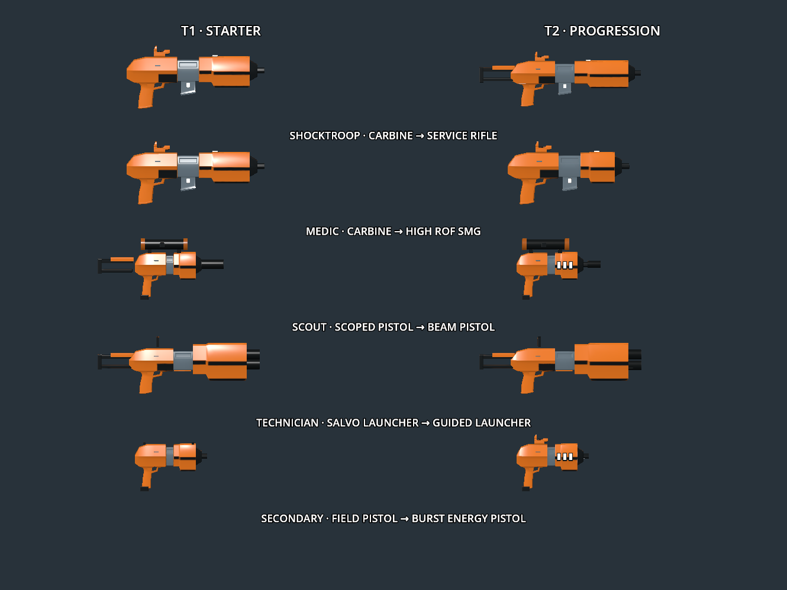

Shared CQ firearm prototype, Godot 4.7.2 / Blender 4.5.9, 2026-10-13.

This records the initial detailed prototype. Current runtime exports have since been [optimised and rebaked](../cq-weapon-optimization/README.md), retaining these detailed authoring files as source references.

All ten firearms are rebuilt from the original CC0 carbine modules, following the supplied orange/black reference. The receiver, grip, bridge, housings and finish stay consistent across classes. The discarded T2 decimation studies are not used. Models preserve manufactured bevels, clean normals and one baked 1,024×1,024 atlas/material. Geometry optimisation is deferred: exported firearms currently contain 2,637–5,720 triangles, explicitly marked `optimization_pending` in the manifest. Utility cases/tools retain their earlier budget.

| Class | Starter | Second primary, 1,000 class XP |
| --- | --- | --- |
| Shocktroop | Shared carbine | Stocked service energy rifle, 800 RPM, 180 m, 1.5× dot |
| Medic | Shared carbine | Compact projectile SMG, 1,000 RPM, 60 m |
| Scout | Suppressed scoped pistol, 1.5× / 3× / 6× | Hitscan beam pistol, 2× / 4× / 8× |
| Technician | Three-charge salvo launcher | Single-shot guided energy launcher, continuous 1.5 s enemy vehicle lock |

The common field pistol keeps iron sights. A three-bolt burst energy pistol with red dot unlocks at 1,500 class XP for the common secondary slot. Scout retains its ammo-free designation tool in that slot until selecting the burst pistol. Class tools and abilities remain available. Loadout selection is checked by the server and takes effect on the next spawn; XP persists for this session, not across application restarts.

Primary weapons carry three spare reloads, except the scout starter pistol (five) and both heavy launchers (two packs). Common secondary weapons carry one spare. Handles and magazines/packs are separate fitted nodes sharing the baked atlas; reload animations preserve their authored resting positions. The heavy packs insert from the side. VR scope steps use gun-hand stick up/down with smooth zoom; desktop right-button aiming uses up/down arrows. The guided weapon's monitor displays SEARCH, acquisition percentage and LOCK. Friendly targets, stale input and blocked sightlines cannot acquire a lock; launched homing stops tracking a destroyed or newly friendly target.

[Asset validation](validation.json) covers all fifteen GLBs, counts, single materials/textures and UVs, 1K firearm atlas dimensions and fitted ammo nodes. [Test results](results.json) cover class rules, actual arena integration, progression gates and spawns, projectile travel/range, burst timing, vehicle acquisition/homing, scopes, ten rendered reload models, spotting and two-process unlocked-loadout replication. The rendered Forward+ progression run passed all checks. Captured engine shutdowns retain inherited ObjectDB/resource warnings; the rendered run also reported PulseAudio microphone teardown noise. These are not measured headset comfort, balance or sustained 32-human frame-time results.

The 32-player fixture includes unlocked primaries, burst secondaries and technician lock state. Normal snapshots use nine packets with a maximum of 1,091 bytes. The downed/supply/grenade stress fixture uses fifteen packets; its 1,243-byte membership record uses the existing reliable fallback. There are no drivable vehicles placed in the prototype terrain; vehicle fixtures and occupied BA2 hulls exercise targeting.

Editable source modules are in [modular_authoring](../../../tools/cq_assets/modular_authoring), and the Krita master is [modular_finish.kra](../../../tools/cq_assets/modular_finish.kra). Rebuild using [build_modular.py](../../../tools/cq_assets/build_modular.py); source credits and fetching instructions are in [SOURCES.md](../../../tools/cq_assets/SOURCES.md). Blender MCP was used for model inspection and Krita MCP for the coherent finish palette.

Closeups: [carbine](carbine.png), [service rifle](assault_rifle.png), [SMG](smg.png), [field pistol](pistol.png), [scout pistol](scout_pistol.png), [beam pistol](beam_pistol.png), [salvo launcher](massacre.png), [guided launcher](guided_launcher.png), [burst pistol](burst_pistol.png), [designator](designator.png).
