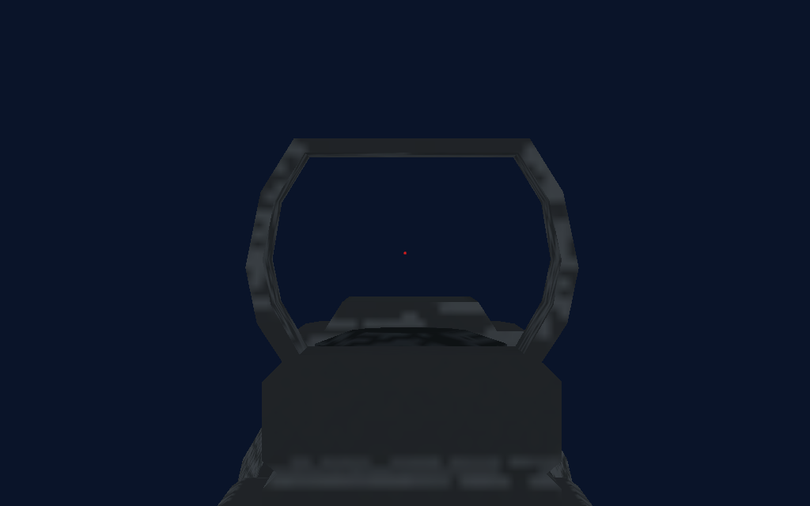
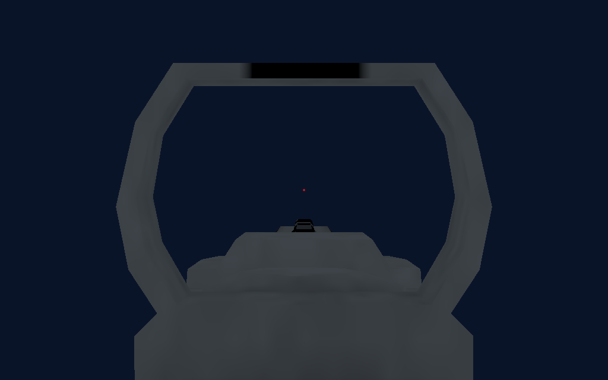
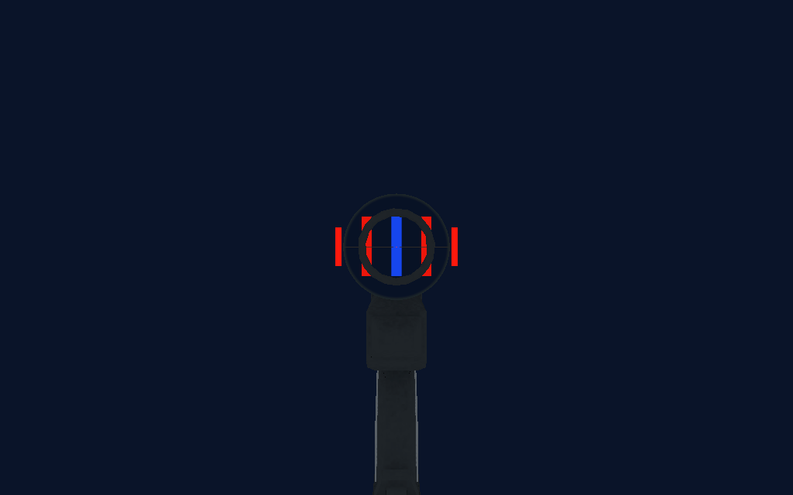

# CQ vehicle and weapon test fixes — 16 October 2026

Branch: `experimental/cq-voxelspace`. This checkpoint also includes the preceding native runtime ports, tier asset overhaul, bike and jump-swimming work; their detailed validation reports remain in the adjacent validation directories.

Scout T1 uses the source scope's actual lens endpoints and aperture, a movable receiver slide without a charging-handle cube, a cupped support-hand anchor, and shoulder-only stock engagement. T2 has a 3× rectangular camera monitor projecting to the offhand side (mirrored for left-handed play). T3 thermal glass matches the existing rear-facing screen, including its size and orientation. Native railgun hit events now take the beam/trail presentation path.

The upgraded pistol repeats while held and consumes ammunition for every shot. The T2 launcher can fire an unguided rocket without a vehicle lock; a completed lock still supplies a homing target. T2 launcher and Massacre source lengths are increased by about 8%. The minigun palm is centered on the rear handle, the support anchor is on the upper carry handle, and its box reload uses the same 6.6-second arming delay as Massacre without a charging handle. Its reload contact cannot claim the offhand as a nonexistent bolt.

Airstrike designation reaches 2 km instead of stopping at 200 m, and near-vertical aim uses the player's heading as the aircraft's approach direction. The five-second hold and stationary requirements remain. The carried technician sentry is the actual turret model and routes to utility slot 6; previously it selected designator slot 8, which cannot deploy a sentry.

Medic SMGs are 10% shorter and their top housings act as laser projectors with a visible contact spot. Source barrel/sight meshes below 200 triangles are preserved during complex-weapon reduction, preventing the T3 burst rifle's low-poly barrel from being collapsed. Budgets remain 5,000 triangles for ordinary weapons and 7,000 for complex weapons.

Reticle math retains the existing per-eye collimation. The [suggested VR reflex shader](https://godotshaders.com/shader/reflex-red-dot-holographic-sight-shader-vr-compatible/) was reviewed: it uses the same view-direction principle. The correction here is geometric: the carbine glass depth and assault sight's actual window center, rather than the entire housing bounds (which include a base and side knob). The correctly aligned burst optic is unchanged.

Bike handle acquisition includes a bounded 20 cm rearward capsule with a 13 cm radius. Attached hands still use the physical handle positions. The all-vehicle fixture retains its original lineup anchor across resets.

## Validation

See [results.json](results.json). All assertions passed:

- Native C++: 268,437 checks, including the 64-player / 3,600-tick deterministic replay; new sustained-fire/ammunition, dumb-fire, pack-delay, long-distance and vertical airstrike tests.
- Weapon tiers: 135 checks, including monitor rendering, thermal range and magazine/slide geometry.
- Stock and foveation: 23 checks, including no arm's-length scout stock engagement.
- Vulkan rendered optics: 34 checks, including collimation through the actual carbine/assault housings, scope magnification and NVG camera isolation.
- Bike: 58 checks; transport wheel: 25; live carried-equipment integration with simulated tracked controllers: 52.
- Local client/server smoke: all five kinds near spawn, 23 map vehicles, four class XP tracks at 7,500 (level 15), destruction enabled, 64-slot configuration and adaptive tick. This is one connected client, not a 64-client capacity certification.
- Portable Linux client/server and Windows MinGW native builds, with current source/build receipt verification. GLB triangle counts, UVs, atlas dimensions and native/client anchor generation validated.

The headless network client retains the existing exit-time ObjectDB/resource-leak diagnostic. No gameplay assertion failed. These checks do not substitute for a fresh physical headset/controller review of grip comfort and final optic alignment; no new VR session was launched for this fix pass.

