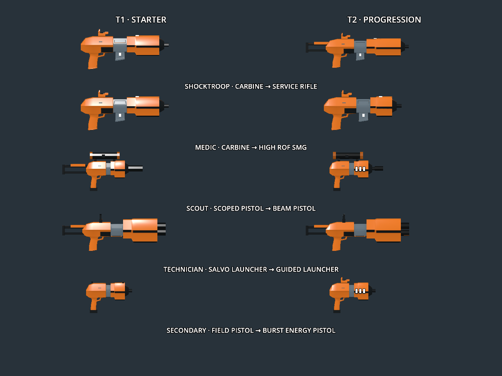

CQ weapon fitting and launcher update, 2026-10-13.

The scoped pistol's stock rails now extend into the shortened receiver, closing the gap while retaining the butt position. All five pistol-frame models (field, scoped, beam, burst and designator) have a continuous black magazine base covering the complete lower magwell perimeter. Both launcher packs sit against fixed receiver sockets. Their screens have receiver-mounted pedestals, with the T2 guidance text visible on the mounted display. Both launchers omit charging handles; magazines/packs remain separate animated nodes. The detailed and optimised Blender authoring files are updated, and the affected geometry is unwrapped and rebaked to the existing single 1K palette/AO atlas.

Current firearms export 595–995 triangles, including reload parts; the T1 launcher has 800 and T2 has 736. The ten firearms total 8,692 triangles. [Validation](validation.json) checks all fifteen models, budgets, single materials/textures, UVs, reload nodes and absent launcher cocking handles. [Rear scoped-pistol view](scout_pistol-rear.png), [pistol underside](pistol-bottom.png), [T1 launcher mounts](massacre-rear.png) and [T2 launcher mounts/display](guided_launcher-rear.png) show the corrected fittings. Additional rear/underside views accompany this report.

Both launcher packs contain **three charges**, with two spare packs (nine total charges). T1 holds the trigger for **0.35 s** before launching; release, stale input, a blocked muzzle, menu/reload or holstering cancels an unfinished charge without spending ammunition. Once committed, the three-blast salvo spends the complete pack, with **0.15 s** between blasts. Empty-pack replacement starts after the salvo, taking **2.7 s** on desktop. VR seats a fresh pack from the side and arms it immediately, with no cocking gesture.

T2 launches **one charge per shot** after the existing **1.5 s / 200 m** enemy vehicle acquisition. If the pack still has charges, a **2.7 s internal reload** readies the next one; no pack swap or cocking is needed. The third shot empties the pack, requiring a new three-charge pack. Desktop replacement takes 2.7 s; VR replacement uses the same side insertion as T1. Timers and remaining-charge counts replicate. The screen shows RELOAD during internal cycling, PACK when empty, and acquisition/LOCK otherwise. Mixed old clients are excluded by the updated CQ profile protocol.

The [stat snapshot](stats.json) is extracted from current runtime definitions by [compare_weapons.gd](../../../tools/cq_assets/compare_weapons.gd). Damage below is nominal unarmoured direct damage; rates assume timely trigger input and exclude reload pauses. Projectile travel, spread and misses reduce realised output.

| Class / weapon pair | Body damage T1 → T2 | Nominal rounds/min T1 → T2 | Magazine T1 → T2 | Nominal direct DPS T1 → T2 |
| --- | --- | --- | --- | --- |
| Shocktroop: carbine → service rifle | 18 → 16 | 500 → 800 | 30 → 36 | 150 → 213.3 |
| Medic: carbine → SMG | 18 → 12 | 500 → 1,000 | 30 → 40 | 150 → 200 |
| Scout: scoped pistol → beam pistol | 40 → 55 | 100 → 75 | 7 → 10 | 66.7 → 68.8 |
| Common sidearm: field pistol → burst energy pistol | 25 → 14 per bolt (42 per three-bolt burst) | 171.4 → 500 bolts (166.7 bursts) | 7 → 18 (six bursts) | 71.4 → 116.7 |

With ideal desktop reload timing included, these pairs yield approximately **93.1 → 117.6**, **93.1 → 104.3**, **43.8 → 53.9**, and **37.6 → 57.8** sustained direct DPS respectively. Those are arithmetic estimates, not target-range measurements; VR reload speed is player dependent.

| Class / pair | Effective range / targeting | Sight T1 → T2 | Total spawn ammunition T1 → T2 |
| --- | --- | --- | --- |
| Shocktroop | 160 → 180 m | Unmagnified dot → 1.5× dot | 120 → 144 |
| Medic | 160 → 60 m | Unmagnified dot → unmagnified dot | 120 → 160 |
| Scout | 200 → 250 m | 1.5× / 3× / 6× → 2× / 4× / 8× | 42 → 40 |
| Common sidearm | 100 → 90 m | Iron sights → unmagnified dot | 14 → 36 |
| Technician | Ballistic salvo → vehicle homing with 200 m acquisition | Salvo display → guidance monitor | 9 → 9, in three-charge packs |

The starter carbine currently has zero base spread; the service rifle uses 0.6° per axis and the SMG 1.8°. The service rifle improves cadence, reach and bolt speed (70 → 90 m/s) while lowering damage per bolt. The medic SMG trades reach and accuracy for close-range cadence and faster projectile travel (150 m/s). Scout headshot damage increases 100 → 110, but fire rate falls; its T1 report is suppressed. The burst secondary trades a little reach for larger reserve ammunition and burst output. Scout starts with its ammo-free designator in the secondary slot, so its burst unlock replaces that tool rather than the field pistol.

T1 ordnance deals **100–120 direct damage per blast** to player targets (300–360 across the salvo); T2 deals **100 per guided shot**. Both retain **120 nominal splash / 5 m radius**, Quake falloff and exclusion of the directly hit victim from splash. Vehicle components receive the fixed direct damage value. T1 flies at 25 m/s with 12 m/s² gravity; T2 at 40 m/s with no gravity. Both have 10 s projectile lifetimes. The inherited `range: 100` definition is not a rocket flight-distance limit: movement is governed by velocity, gravity, homing and lifetime. Under uninterrupted desktop firing, T1's first-blast interval between packs is about 3.35 s; T2 can launch every 2.7 s while maintaining lock. Their nominal direct-only sustained output is roughly 89.6–107.5 versus 37.0 DPS; the T2 trades salvo output and anti-personnel use for vehicle tracking and control of each charge.

[Checks](results.json) pass class rules, all ten reload/scope models, real-arena salvo charge/cancellation, all three guided charges and replacement, continuous vehicle lock/homing, both support-hand orientations for no-cock VR pack insertion, two-process class/progression replication, and Vulkan Forward+ progression/rendering. The 32-player fixture uses ten normal packets with a 1,094-byte maximum; its downed/supply/grenade stress fixture uses sixteen packets with only the 1,243-byte membership record taking the existing reliable fallback. Engine resource/ObjectDB shutdown warnings remain inherited. Physical headset comfort and gameplay balance still require playtesting.

Rebuild using `build_modular.py ... --optimized`; `--only` accepts a single model or comma-separated names. Detailed modules remain in `tools/cq_assets/modular_authoring`, optimised modules in `optimized_authoring`. Source licences, the shared Krita palette and credits are unchanged. The benchmark in the preceding optimisation report records the geometry before these fitting corrections and launcher changes.
