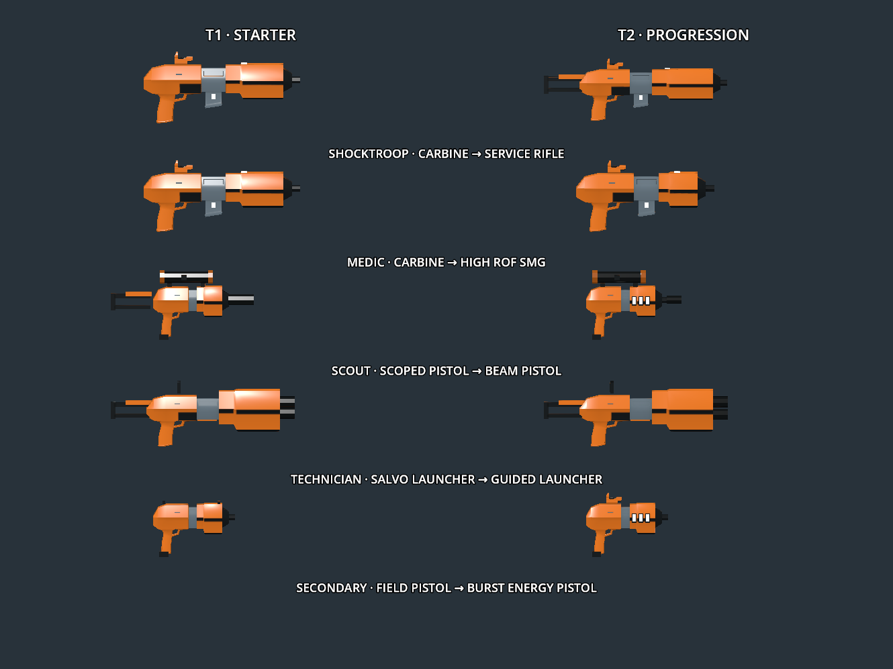

CQ firearm optimisation, Godot 4.7.2 / Blender 4.5.9, 2026-10-13.

This captures the initial optimisation benchmark. Subsequent [fitting corrections, launcher mechanics and current stats](../cq-weapon-fittings/README.md) retain the triangle budget and update the current runtime assets.



The current runtime firearms are rebuilt from the same original modules, with selective one-segment receiver bevels, existing housing chamfers, material-preserving planar edge dissolve and eight-sided open bores/scopes. Small windows, handles, packs and stock struts retain their shape without additional bevel geometry. The requested red-dot sight retains its source shape after dissolving redundant planar edges. No collapse decimation or voxel remeshing is used. Each weapon is freshly unwrapped and baked to one 1,024×1,024 colour/AO atlas, keeping the orange/graphite/ceramic/steel palette. Eight-sided scope collars and suppressors are visibly more angular at close range.

| Firearm | Before | Optimised triangles | Reduction |
| --- | ---: | ---: | ---: |
| pistol | 2637 | 595 | 77.44% |
| scout pistol | 4605 | 899 | 80.48% |
| carbine | 4942 | 903 | 81.73% |
| designator | 5720 | 955 | 83.3% |
| massacre | 3922 | 788 | 79.91% |
| smg | 5002 | 903 | 81.95% |
| assault rifle | 5374 | 951 | 82.3% |
| burst pistol | 5720 | 955 | 83.3% |
| beam pistol | 5469 | 995 | 81.81% |
| guided launcher | 3538 | 724 | 79.54% |

The ten exports total 8,668 triangles, down from 46,929 (81.5%). These counts include separate charging handles and inserted magazines/packs. All exports and the validator's mesh attachment allowances stay below 1,000 triangles; the largest export is the beam pistol at 995. Atlas resolution and GPU texture memory are unchanged. Combined GLB file size drops from 6,700,580 to 4,951,844 bytes (26.1%); embedded texture bytes account for much of the remainder.

[Comparison](comparison.json) verifies unchanged muzzle, optic, zoom, monitor and pack insertion markers, with bounds changes below 4 mm. [Asset validation](validation.json) verifies fifteen GLBs, triangle budgets, one material/texture, single atlas UV maps, 1K firearm PNG dimensions and separate reload nodes. [Runtime checks](results.json) pass 45 model/reload/scope checks, 53 progression/combat checks and 33 actual-arena/32-player snapshot checks. Closeups of all ten exports were inspected in Godot Forward+; the beam pistol was also imported and inspected through Blender MCP. Inherited ObjectDB/resource shutdown warnings remain in arena test logs.

The [isolated rendering benchmark](profile.json) alternates baseline and optimised models across three pairs of runs, with 90 warmup frames and 240 sampled frames per run. It places 32 mixed weapons in view at 1,280×800, Vulkan Forward+, 4× MSAA, VSync disabled, on Intel ADL-N. Median values below are the median of the three run medians.

| Measure | Before | Optimised |
| --- | ---: | ---: |
| GPU rendering | 12.185 ms | 10.823 ms |
| Wall frame interval | 12.707 ms | 11.335 ms |
| CPU rendering | 0.689 ms | 0.687 ms |
| Rendered triangles | 148,029 | 27,498 |
| Draw calls | 30 | 30 |

GPU rendering improved by 11.2%; CPU cost and draw calls stayed essentially unchanged. This measures weapon geometry in isolation, with no avatars, terrain, physics or network simulation, and does not predict a complete 32-player match. Shader instancing keeps the repeated mesh submissions at 30 in both variants.

Original detailed authoring files remain in [modular_authoring](../../../tools/cq_assets/modular_authoring). Editable optimised modules and baked exports are in [optimized_authoring](../../../tools/cq_assets/optimized_authoring). The shared Krita palette is unchanged. Source licences and credit remain in [SOURCES.md](../../../tools/cq_assets/SOURCES.md).

Rebuild current exports from the repository root after fetching the pinned source assets:

```sh
blender -b --python tools/cq_assets/build_modular.py -- test-results/weapon-sources deathmatch/weapons/cq --optimized
python3 tools/cq_assets/validate.py
```

Add `--audit` to inspect module triangle counts without baking or changing exports. Omitting `--optimized` rebuilds the detailed prototype. Run closeups/family rendering through the existing `preview_tier2_closeups.gd` / `preview_family.gd` scripts.

To repeat the benchmark, extract the ten baseline GLBs from commit `5d29b26` into `test-results/weapon-sources/optimization-baseline`, then run:

```sh
godot --path . --xr-mode off --audio-driver Dummy --script tools/cq_assets/profile_optimization.gd
```

The raw report is written to `test-results/weapon-sources/optimization-profile.json`.

Closeups: [carbine](carbine.png), [service rifle](assault_rifle.png), [SMG](smg.png), [field pistol](pistol.png), [scout pistol](scout_pistol.png), [beam pistol](beam_pistol.png), [salvo launcher](massacre.png), [guided launcher](guided_launcher.png), [burst pistol](burst_pistol.png), [designator](designator.png).
