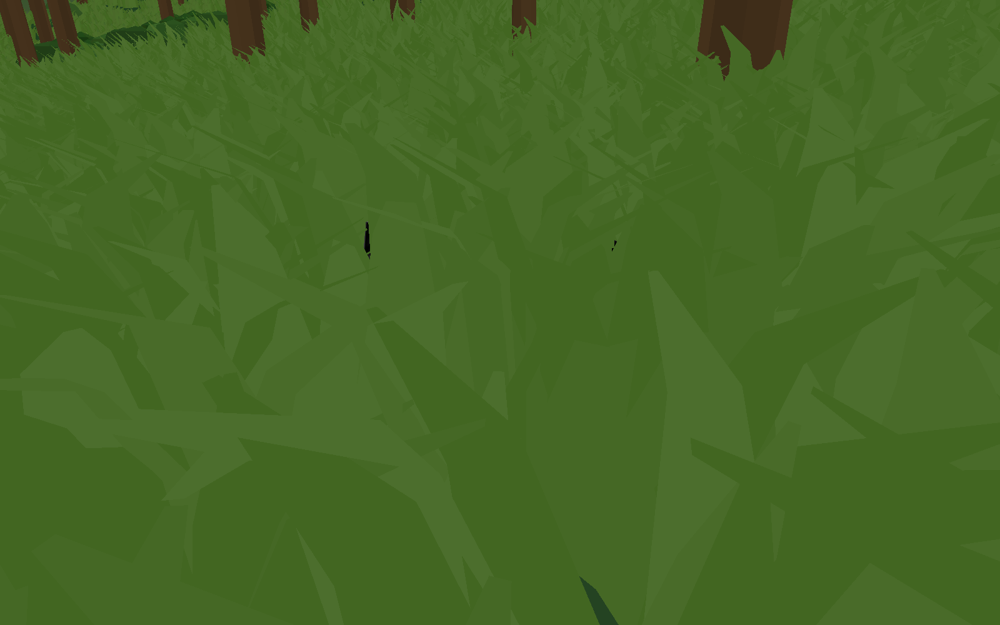

# Wider grass bases and denser prone cover

Grass now begins around a 0.68 m root radius with 0.46 m wide root ribbons tapering toward the tips. Broad-leaf clumps have a 0.52 m root radius. Near/middle meshes retain their existing triangle counts, and the far atlas was rebaked from these meshes. Candidate occupancy rises from 55% to 90% on the same bounded 32×32 tile grid, about 64% more clumps before terrain exclusions. Tall grass remains 92.5% of resident foliage, with occasional mixed broad-leaf/bush patches.

No collision or AI concealment rule is added. Road/site/water/rock/slope exclusions, shared terrain streaming, deterministic placement, LODs, 96 m default distance and 30 Hz movement refresh remain. Visible workload is capped at 2,048 instances and 12 draws per eye. GPU transform allocation now matches the per-group budgets: 2,048 instances total instead of 24,576. Species are cached once per streamed row and culling buckets partition distance and species to avoid repeated classification on movement refresh.

## Matched 3 m observer

The [previous capture](../jungle-prone-observer/README.md) remains unchanged. This repeats the same Macron avatar, native Breath1 frame 25 with prone transform, map location, 1.7 m standing eye, 3 m horizontal distance and 60° FOV. The complete transformed avatar remains at least 3.5 cm above the sampled terrain; concealment does not come from burying it.

Four frozen captures isolate the avatar by rendering each foliage state with and without the avatar. Reference pixels have RGB maximum difference greater than 3/255 between the foliage-off pair. Visible pixels also exceed that threshold in the foliage-on pair. This measures visible screen pixels, not a player detection probability. The receipt records 57,795 reference avatar pixels and 396 visible pixels: **99.31% concealed in this view**. Other locations, angles, avatar poses and moving observers are not guaranteed safe by this single check.



[Avatar without grass](prone-reference.png), [grass without avatar](grass-background.png), [reference without avatar](reference-background.png), [receipt](receipt.json).

## Validation

3,910 checks passed, zero errors. These cover deterministic terrain placement, dominant grass/mixed species, per-tile candidate limits, cache sizes, GPU group allocations, LOD geometry/cards, opacity and mipmaps, collision-free foliage, 24–144 m distance controls, hard budget saturation, 30 Hz refresh, flight suppression, eviction/reload and identical workload on return. Residency peaked at 245/384 terrain tiles and two jobs. Peak foliage rows were 206,454; 196,677 were resident at the end. The tested default view submits 1,511 clumps and 59,642 triangles, within the same 2,048-instance/12-draw caps.

## Reproduction

```sh
godot --xr-mode off --rendering-method forward_plus --rendering-driver vulkan --path . --script tools/voxel_battle/bake_undergrowth.gd
godot --headless --xr-mode off --path . --editor --import
godot --headless --xr-mode off --path . --script tools/voxel_battle/validate_grass.gd -- --output res://test-results/jungle-prone-cover
godot --xr-mode off --rendering-method forward_plus --rendering-driver vulkan --path . --script tools/voxel_battle/prone_observer.gd -- --seed 4127984082040278291 --reference-receipt res://docs/validation/jungle-prone-observer/receipt.json --output res://test-results/jungle-prone-cover
godot --xr-mode off --rendering-method forward_plus --rendering-driver vulkan --path . --script tools/voxel_battle/benchmark_jungle.gd -- --grass-test --grass-distances 96 --views 0,3 --seconds 10 --output res://test-results/jungle-prone-cover/stereo
```

## Final stereo cost check

Godot 4.7.2, Intel Arc A770, Vulkan Forward+. Two independent 2,160×2,376 eye viewports, 64 mm IPD, 92° vertical FOV. Hybrid trees, terrain and structures remain identical. No avatars, AI or physics participate in this performance test. Standing Canopy edge and Prone canopy repeat the same five-second ±2 m movement/yaw sweep, with grass off and current grass at 96 m. Each case has six seconds warmup and ten seconds measurement; captures are excluded. This is a simulated stereo test rather than native WiVRn timing.

10,529 measured frames across 40 seconds, all with settled terrain.

| View | Frame median off/on (ms) | Frame p95 off/on (ms) | Stereo GPU median off/on (ms) | Grass CPU refresh median/p95 (ms) |
|---|---:|---:|---:|---:|
| Canopy edge | 3.335 / 3.439 | 3.803 / 10.065 | 1.335 / 1.442 | 6.390 / 6.591 |
| Prone canopy | 3.340 / 3.518 | 3.782 / 10.451 | 1.260 / 1.442 | 6.671 / 7.064 |

CPU refresh timings measure actual refreshes, not skipped frames. CPU/GPU work overlaps and the numbers cannot be summed or subtracted to infer a bottleneck. This short paired run checks cost and bounds; GPU differences include run variation. Older narrow-base receipts remain available for context but used fifteen seconds per case and are not a simultaneous controlled comparison.
