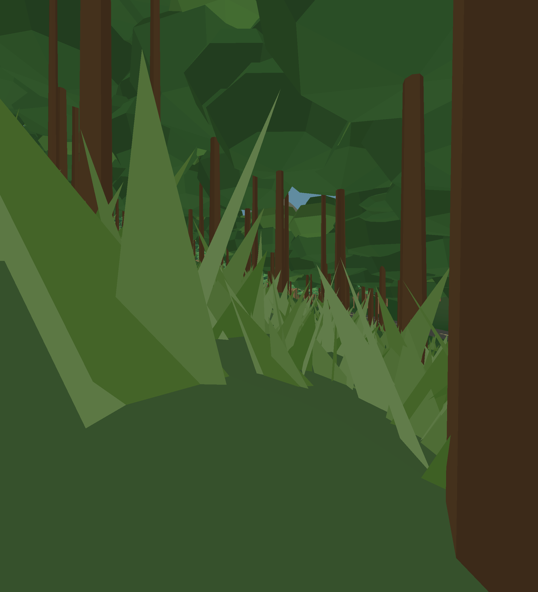

# Constrained jungle undergrowth and broad road earthworks

Hybrid trees remain the default. The generic grass/fern-like clumps supply visual
cover at prone height with 768 total visible clumps, a 24 m cutoff, two LODs and
at most two opaque MultiMesh draws per eye. The terrain atlas supplies distant
cover. The experiment is enabled and can be toggled in the preview.

## Final simulated stereo comparison

Godot 4.7.2, Vulkan Mobile, Intel Arc A770. Two 2,160×2,376 independent eye
viewports, 92° vertical FOV, 64 mm IPD. Hybrid trees, terrain and structures are
identical in both cases. No avatars, AI or physics simulation. Each phase uses
a five-second ±2 m walking/small-yaw sweep at terrain-relative height; six-second
warmups and image captures are excluded. Three standing views (1.7 m) and one
prone view (0.45 m), off/on for 15 seconds each: **120 measured seconds**.

**52,965 frames**, all with settled terrain. The full run including generation,
warmups and captures took 200.74 seconds.

| View | Stereo GPU median off/on (ms) | App frame median off/on (ms) | App frame p95 off/on (ms) | Visible clumps median/max | CPU refresh median/p95 (ms) |
|---|---:|---:|---:|---:|---:|
| Canopy edge | 0.980 / 1.002 | 3.270 / 3.240 | 3.713 / 3.965 | 319 / 327 | 0.681 / 0.724 |
| Canyon overlook | 0.987 / 1.005 | 3.366 / 3.432 | 3.851 / 4.292 | 328 / 353 | 0.701 / 0.760 |
| Mountain foothills | 0.446 / 0.450 | 1.101 / 1.099 | 1.448 / 1.349 | 0 / 0 | 0.029 / 0.036 |
| Prone canopy | 0.952 / 1.189 | 3.284 / 3.272 | 3.707 / 4.012 | 320 / 325 | 0.689 / 0.742 |

The prone view's median stereo GPU increase is **0.237 ms**. The two standing
forest views add 0.022 and 0.018 ms. The high/sparse foothill view submits no
grass; its 0.004 ms difference is background variation. Application medians
change little, while p95 rises by 0.25–0.44 ms in the vegetated views. Periodic
CPU refreshes cost about 0.7 ms, capped at 30 Hz; skipped frames reuse buffers.
These are paired measurements, not a claim of statistical significance or free
rendering. CPU/GPU overlap means their timings cannot simply be subtracted.

The original render used an overly bright leaf colour space. It was corrected
to match the existing tree materials and the whole comparison above was rerun.
Only the corrected run is included here. Mode-list metadata was normalized after
collection; no frame samples or summaries changed.

This tests visual near-field cover. Undergrowth has no collision or bot detection
rule; its geometry does not occlude a player beyond the 24 m budget. Normal
terrain/trees and terrain-colour camouflage remain at longer range. No avatar
concealment percentage or native WiVRn performance is inferred from these images.

[Without undergrowth](stereo/3-off.png). Captures are illustrative, taken after
the measured sweeps; they are not pixel-aligned occlusion measurements.

## Road and simulation checks

* Terrain: **12,923 checks**, zero failures, 3,450 road-clearance
  samples against all structure LODs; six reserved pads remain flat.
* Earthworks: **512 samples** on high fill/cut sections. At four
  metres beyond the three-metre shoulder, maximum sampled bank height difference
  was 2.22 m. Transition radii grow to 220 m where needed.
* The eight major POI connectors are 13.1–22.4% longer than their straight
  endpoint distances, with aligned gate tangents and curved intermediate points.
* Undergrowth: **1,689 checks**, zero failures. Tests exercise hard cap
  saturation, LODs, 24 m distance, colour space, opacity, shadow suppression,
  30 Hz refresh, flight suppression, deterministic placement and tile eviction.
* Full-world collision/navigation: **97 checks**, zero failures. All existing
  POIs and 38 storeys remain reachable. 196 chunks,
  1,221,896 polygons, 204 seam links; zero water vertices.
* Staged 4,096-polygon searches reach every POI through a 526-node road graph.

Intentional water-hole ray probes still produce native NaN-normal warnings, and
Godot emits some navigation border/edge-merge warnings. Empty terrain-face chunks
are now skipped instead of passed to the navigation API. Functional navigation,
water-hole and boundary checks pass. The 16v16 match was not benchmarked here.

## Streaming budget and reproduction

Peak terrain residency was 245 / 384 tiles; two worker jobs maximum.
Worker generation median/p95 was 60.21 / 98.51 ms, including
terrain earthworks and packed undergrowth; uploads were 0.026 / 0.037 ms.

Source, limits and exact commands: [Jungle map documentation](../../JUNGLE-8KM2.md).
Raw frame intervals are in `stereo/frames.csv.gz`; per-view counts and CPU refresh
summaries are in `stereo/results.json`. `terrain.json`, `physics.json` and
`undergrowth.json` retain validation receipts. `source-sha256.json` fingerprints
the final implementation and assets. Krita's layered plan was refreshed from the
current terrain source while retaining the site-label layer.
