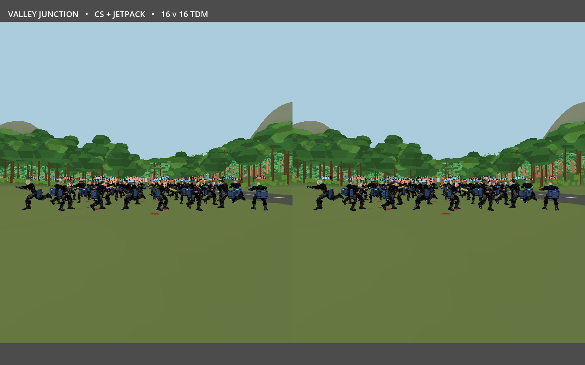

# Current 64-avatar shooting profile, 120 seconds

**CPU simulation is the main measured cost. Movement/collision calls are the largest isolated category**, averaging 40.11 ms per rendered interval (45.99 ms median). The timer wraps the actual Fighter.simulate implementation including move_and_slide and step/ground checks; it does not split the native collision implementation internally.

Godot 4.7.2-stable (fedora), Vulkan **Forward+**, Intel(R) Arc(tm) A770 Graphics (DG2). Same seven World Leaders skins and formation/seed 1977 as the earlier 64 test, rebuilt with the accepted constrained head/neck/two-arm solver. Native vertex animations cycle idle/walk/run while each stationary authoritative actor fires CS weapons toward random directions. Synthetic validated headset/controller input drives production aiming and IK. **No AI or navigation**, no deaths, large reserve ammo and real reloads. Terrain, hybrid trees and widened/denser hybrid undergrowth use the current shared stream and culling; camera is stationary on the reserved Canopy outpost pad. Two 2,160×2,376 independent eye viewports, 64 mm IPD, 90° FOV, vsync off. This is simulated stereo; native WiVRn pacing, transport and encoding are not measured.

The measurement lasted **120.011 wall seconds**, after terrain settlement and 180 warmup frames. It contains 933 process samples and 934 post-draw samples, all with settled terrain. Simulation advanced 107.583 seconds across 6,455 ticks: 6.92 ticks per rendered process sample on average. All 64 avatars remained visible in both eyes and all 64 had tracking active. The receipt reports 30,008 shots, 1,056 reloads, zero deaths and zero AI calls.

## Frame cadence and rendering

| Counter | Median | p95 | Unit |
|---|---:|---:|---|
| Actual post-draw wall interval | 138.469 | 178.466 | ms per render |
| Engine process delta | 129.111 | 142.476 | ms per process callback |
| Combined eye GPU | 6.121 | 8.598 | ms, two eye counters |
| Combined eye render CPU | 1.402 | 1.622 | ms, two eye counters |
| Authoritative gameplay callback | 10.391 | 21.547 | ms **per physics tick** |
| Synthetic pose generation/validation | 0.760 | 0.880 | ms **per physics tick** |
| Terrain/foliage update, stationary | 0.018 | 0.023 | ms per process callback |

Actual post-draw throughput is **7.79 renders/s**. Engine delta and wall cadence disagree when the physics loop falls behind, so the wall counter is the performance headline. GPU and CPU overlap; GPU counters cannot be added to CPU categories to form a frame budget. Terrain and foliage are settled: 242/384 tiles, 625 visible undergrowth instances, 4 undergrowth draws, 96 m distance. No tree or grass refresh occurs during this stationary measured window; cached buffers remain rendered. This is not a moving-camera foliage refresh test.

## CPU categories per rendered interval

Nested benchmark-only wrappers call the production implementation. **Exclusive CPU times subtract recorded child scopes**; e.g. combat input excludes its nested traces and effect construction. Groups below sum those exclusive raw columns within each interval, then compute percentiles. Mean category times are additive within the instrumented CPU ledger; independent medians/p95 values are not additive.

| Category | Mean (ms) | Median (ms) | p95 (ms) |
|---|---:|---:|---:|
| Movement and collision calls | 40.115 | 45.994 | 47.913 |
| Other server gameplay, melee, pickups, history and snapshots | 29.239 | 33.378 | 35.393 |
| Synthetic input and benchmark tick bookkeeping | 11.906 | 13.584 | 14.387 |
| Weapon hit traces and shot solution | 7.587 | 5.785 | 17.165 |
| Firing/reload input state, excluding nested traces/effects | 4.914 | 4.869 | 9.207 |
| Impact and shot effects dispatch/construction/pool | 3.353 | 2.621 | 7.516 |
| Tracked head/neck/two-arm IK | 1.314 | 1.296 | 1.432 |
| Other avatar animation and held-weapon updates | 1.094 | 1.068 | 1.183 |
| General scene visual update | 0.724 | 0.708 | 0.810 |
| Fighter visual update | 0.665 | 0.458 | 0.520 |
| Effects animation and expiry | 0.188 | 0.208 | 0.307 |

Across complete post-draw intervals, the profiler records 94.427 seconds of exclusive wrapped CPU work out of 119.943 seconds of wall time. **27.319 ms mean per interval remains unattributed**: unwrapped engine/scene callbacks, threaded work/waits and profiler overhead. This residual is not a measured collision/physics category. Detailed categories retain inclusive parent counters and any partial final interval separately; do not sum inclusive parent and child scopes. Clock/counter/CSV instrumentation adds overhead, so this instrumented rerun is not a causal before/after comparison with the earlier Mobile test.

The 64-slot weapon effects pool remains valid, reaches 64 active slots and records 1,296 evictions. Limits remain bounded. These timings confirm that effects construction and IK are smaller measured contributors than movement/collision and other server processing. The 64-avatar workload remains unsuitable for smooth VR at this configuration.

## Audit, sources and reproduction

**255 audit checks passed**. Both CSVs match the recorded samples/percentiles; every render is settled, all head/controller poses validate, shooting occurs without AI/deaths, pool invariants hold and CPU exclusive times remain nonnegative and within inclusive scopes. Process and post-draw samples differ by one at the measurement boundary. Ten ObjectDB instances and three resources remain at shutdown; their cleanup warnings occur after completed valid reports, with no script errors during measurement.

[Result](result.json), [category counters](categories.json), [group mappings](grouped-categories.json), [audit](audit.json), [run log](run.log), [process CSV](frames.csv.gz), [wall/category CSV](categories.csv.gz), [source fingerprints](source-sha256.json).

```sh
godot --xr-mode off --rendering-method forward_plus --rendering-driver vulkan --path . --script tools/ut99_avatar/profile_shooting.gd -- --avatar-count 64 --seconds 120 --output res://test-results/ut99/shoot-64-forward-profile
python3 tools/ut99_avatar/audit_profile.py test-results/ut99/shoot-64-forward-profile
```

[Earlier Mobile/approximate-arm result](../shoot-64-arms/BREAKDOWN.md) retains its original timings. Renderer, IK and foliage have changed, and this run adds instrumentation; their differences cannot isolate the cost of any one change.


