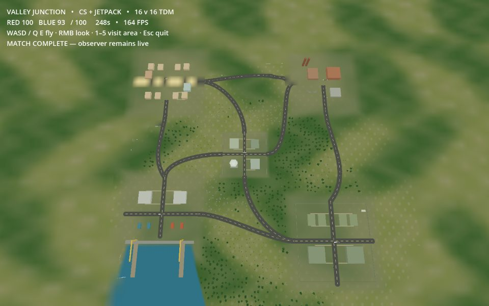
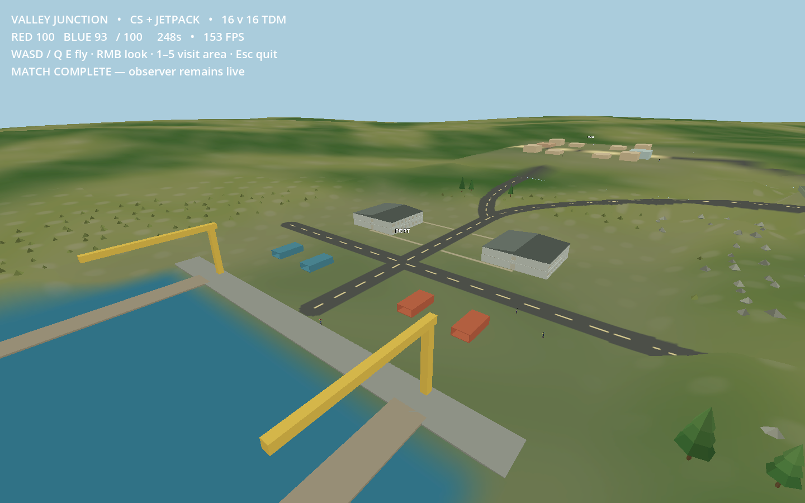
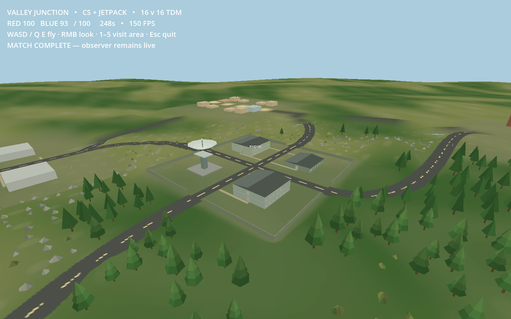
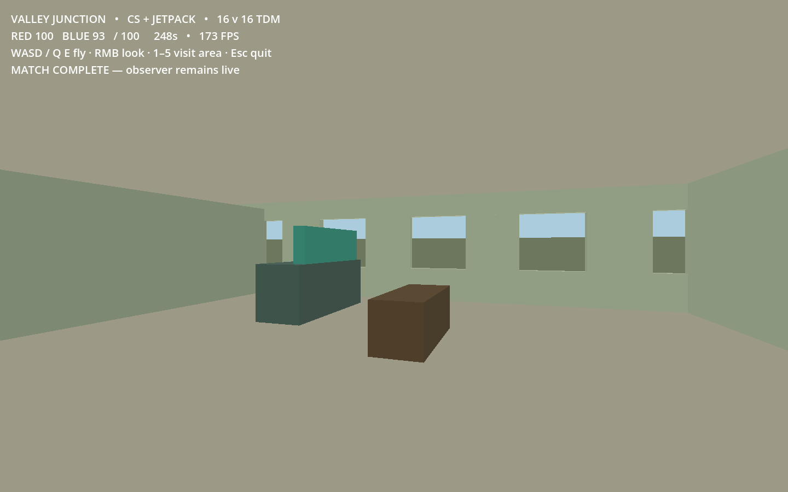

# Valley Junction validation

Godot 4.7.2, experimental/cq-voxelspace, upstream 1c3d05b, with local scenario changes.
The previous layout's receipts remain in `previous-layout/`.

- `geometry.json`: 65,403 checks for physical 170 cm doorway/stair traversal,
  connected storeys, 1,744 full-width road samples against collision and render
  walls in every LOD, 48 entrance lanes, eight raised cover points, deterministic
  ecology, tile seams and manifold navigation edges.
- `water.json`: continuous sea-level harbour to the southern terrain edge,
  vegetation exclusion, safe piers, immediate server-side water death through
  armor/spawn protection, no repeat deaths, no enemy frag and normal respawn.
- `environment.json`: two-worker/384-tile bounds, three asset LODs, frustum
  culling, instance capacity, eviction and deterministic regeneration.
- `avatar-prepass.json`: 1,086 checks preserve oriented triangles, skin/morph/LOD
  data, materials, transparent index order and original VRM bytes.
- `match.json`: full authoritative offline 16v16 CS-style/jetpack TDM match,
  measured bot tick time and its share of authoritative physics time.
- `performance.json` and `frames.csv`: active rendered frame samples, GPU/render
  CPU time, draws, memory, streaming and live-capture overhead.
- `checks.json`: these checks and retained stock movement/team/streaming regressions.
- `source-sha256.txt`: exact scenario and modified core source.

The five POIs occupy the playable perimeter and centre, connected by curved
roads. Entrance lanes stop at asphalt shoulders and use the terrain color atlas.
The harbour opens into an estuary that reaches z = 1024 m; the separate pool
mesh is removed. Sea level is zero. Quay/piers stay safe above the water, while
water terrain cannot contribute walkable collision/navigation. Water death uses
normal TDM suicide scoring and the two-second respawn path.

Spring simulation is disabled for all 32 avatars. The preparation pass compiles
safe surfaces and optimizes opaque/cutout indices once for each of three shared
models, retaining skinning, morphs, materials and original VRM files. Startup,
model preparation and navigation warmup are excluded from rendered timing.
A two-second live JPEG feed and automatic ground-camera tour are active during
measurement; readback/encode cost is reported separately. Post-match captures
freeze the simulation and wait for streaming, and their FPS is not a benchmark.
These are local desktop diagnostic measurements; network and XR were not tested.

The rendered match ended Red 100–93 Blue after 247.65 simulated seconds, with
7,586 shots, 165 jetpack activations, all five sites visited and no friendly damage.
Every bot travelled at least 1.31 km. The 3,230 active rendered frames measured
frame p50/p95 of 74.03/136.67 ms; GPU p50/p95 was 1.27/2.49 ms. Bot AI consumed
66.65% of authoritative physics time (AI tick p50/p95 6.33/29.02 ms versus
whole simulation 10.66/33.84 ms). This confirms AI as the largest measured
simulation component. It does not assign all frame time to AI; movement, physics,
rendering, streaming and validation instrumentation are also active.

The subsequent [32-avatar native OpenXR stereo test](stereo/README.md) uses
WiVRn-Pro / Quest Pro, with no AI attached and all springs disabled. Its receipts
are separate from the match benchmark.
