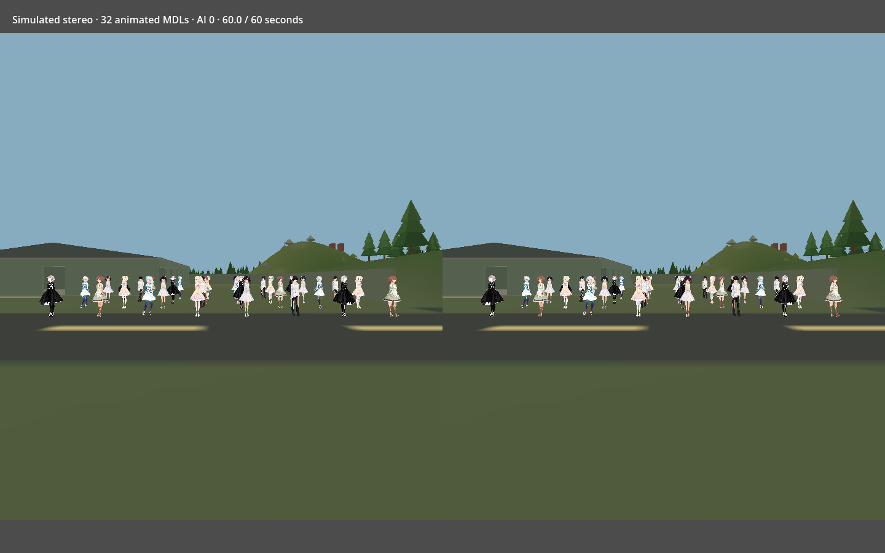

# 32 animated MDL avatars: simulated stereo

Completed 60.001 seconds with 31,062 measured frames on Godot 4.7.2 Vulkan Mobile, Intel Arc A770. The scene remains open with animated avatars. No engine errors were recorded.

Six accepted conversions are used: sample_d_darkness and sample_e (6 instances each), sample_f/g and hairsample_female/male (5 each). Eleven avatars play idle, eleven walk, ten run. Independent phases and GPU vertex interpolation are active; there are no skeletons, morphs, springs, tracking controls, AI or navigation bake. The source geometry remains 170 cm high; movement clips play in place.

Two desktop viewports share the same world and render 2160×2376 each. Parallel perspective cameras have a 64 mm separation and 90° FOV. Both contain all 32 avatar centres. The map uses the same seeded location (37.4246, 20.0, 2.0212) as the VRM test, with terrain/scenery LOD, culling and streaming. The 8×4 crowd is unchanged in position. Terrain and shaders warm up before measurement; eye readbacks occur afterward. Nonempty, distinct left/right captures are checked in `checks.json`.

## Timing comparison

Values are median / p95:

| Measurement | Previous VRM | Simulated MDL |
| --- | ---: | ---: |
| Wall frame | 13.608 / 18.661 ms | 1.851 / 3.783 ms |
| Stereo GPU | 3.876 / 5.524 ms | 0.373 / 1.973 ms |
| Renderer CPU | 0.846 / 0.968 ms | 0.107 / 0.218 ms |

The VRM run used actual OpenXR/WiVRn-Pro/Quest Pro at 72 Hz, native eye projections and runtime settings. The MDL run uses uncapped desktop two-pass stereo, with no OpenXR frame pacing or foveation. Wall-frame reductions cannot be interpreted as avatar-only CPU savings. Renderer CPU counters exclude much script/pose work and are not total CPU time. GPU measurements also differ: native stereo viewport versus sum of two independent viewport passes. Both use the same nominal eye resolution, map point, engine, GPU and 32 avatars, but camera projections, visible geometry, models, shading and animation differ. MDL uses low-poly opaque unshaded skins and baked poses; VRM uses its prepass, live humanoid IK, expressions and full-detail XR policy. Springs and AI are off in both.

Measured medians: draw calls 176 → 97; primitives 462,937 → 185,412. These include the scene and are affected by stereo method/culling. This result indicates substantially lower rendering cost for this MDL scene, not a controlled format-only speedup. A matched native OpenXR run is needed for that comparison.

Reproduce:

```bash
godot --xr-mode off --rendering-method mobile --rendering-driver vulkan --path . --script tools/vrm_to_mdl/stereo.gd -- --seconds 60 --keep-open
```

[Result](result.json) · [Samples](frames.csv) · [Left](left.png) · [Right](right.png)


