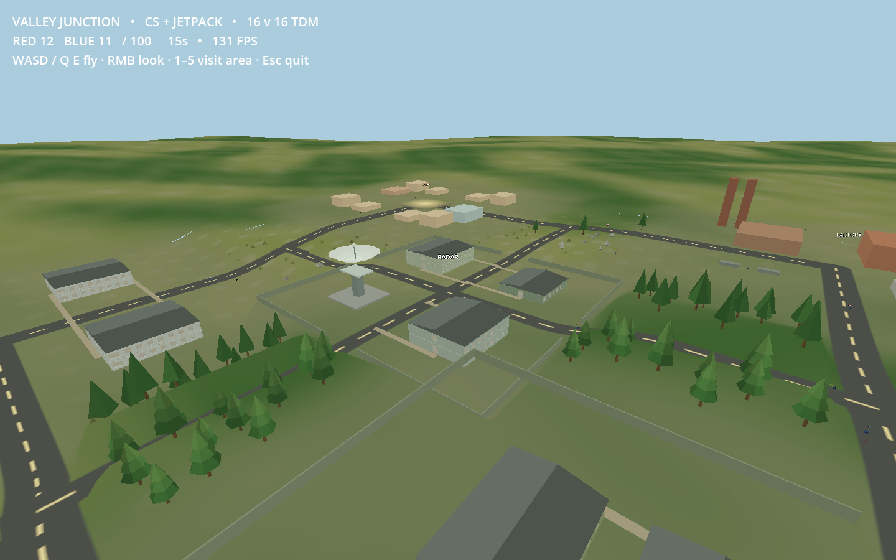
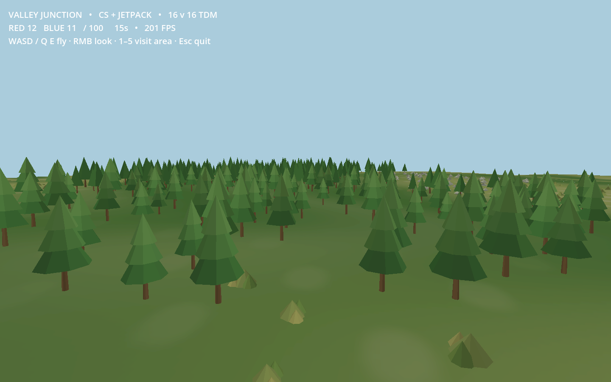
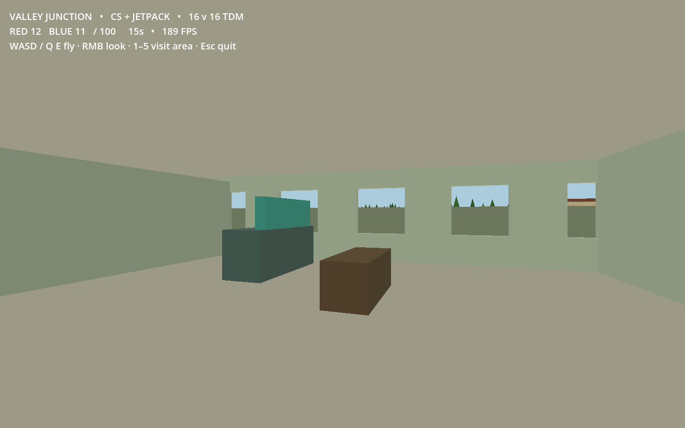

# Valley Junction validation

Godot 4.7.2, experimental/cq-voxelspace, upstream 1c3d05b, with local scenario changes.

- `geometry.json`: physical 170 cm doorway/stair traversal, connected storeys,
  680 road samples against collision and render wall boxes in every LOD,
  deterministic ecology exclusions, tile seams and manifold navigation edges.
- `environment.json`: shared two-worker/384-tile bounds, three asset LODs,
  frustum culling, instance capacity, eviction and deterministic regeneration.
- `match.json`: full authoritative offline 16v16 CS-style/jetpack TDM match.
- `rendered-smoke.json`: a 15-second Vulkan Mobile match, then frozen camera tour.
  Captures wait for terrain jobs to settle; screenshot FPS is not a benchmark.
- `checks.json`: these checks and the stock streaming/movement/team regressions.
- `source-sha256.txt`: exact scenario and modified core source used for this work.

The radar compound adds three buildings and five interior storeys. Both road axes
pass through open 14 m gates. Vegetation uses original opaque procedural meshes,
with pines on gentle moist ground, boulders on exposed ridges, and edge scrub.
Ground-cover colors use the terrain atlas. Environmental rendering has at most
nine species/LOD draws and shares terrain residency instead of a second cache.
Trunks and boulders retain camera-independent collision in the playable area.

The match ended Red 100–93 Blue after 187.1 simulated seconds. All 32 bots
traveled at least 1.25 km; all five sites and all five radar storeys were visited.
Headless tick p50/p95 was 8.70/32.57 ms. Runs overlapped other verification;
this is diagnostic evidence, not a claim of stable 60 FPS. Network and XR clients
were not tested against this generated scenario.
