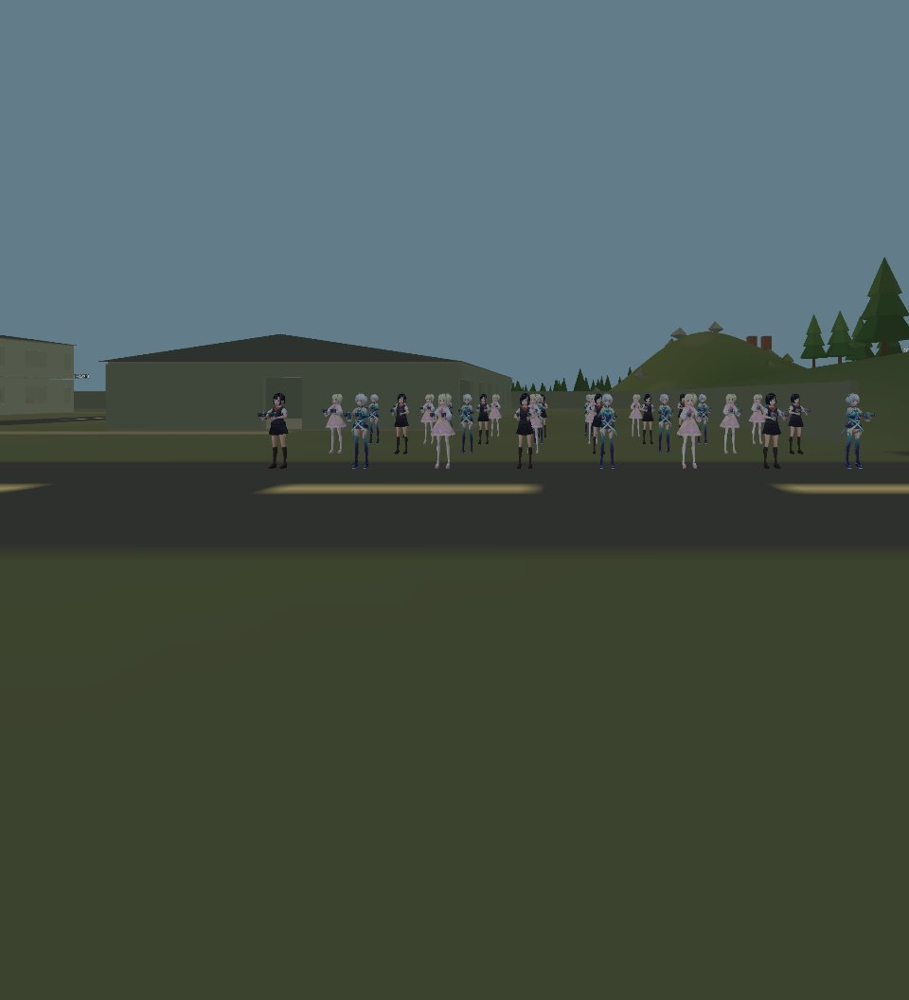

# 32-avatar native stereo rendering test

A 60-second render-only test completed through **WiVRn-Pro 26.9.0 and Meta Quest
Pro**, using Godot 4.7.2 Vulkan Mobile on Intel Arc A770. OpenXR supplied two
native eye views at **2160 × 2376 per eye**, with the headset/runtime at **72 Hz**.

The seeded random clear location was **(37.42, 20.00, 2.02) m**, near the radar
base. Seed 20261012 samples the playable area and rejects submerged, steep,
occupied or visually obstructed crowd footprints. The scene holds 32 animated
1.70 m VRM avatars, using the three bundled models in an 8 × 4 formation. Native
stereo projections, IPD, swapchains and pacing are retained. Head motion is
compensated during this controlled benchmark to keep the viewpoint fixed.

The existing VRM optimization pass compiled safe surfaces and optimized opaque
indices once per shared model. All 32 secondary-motion systems were verified
inactive. Live idle animation, humanoid IK and expressions stayed active, with
the normal conservative full-detail XR pose policy. No Arena, bot controller,
CharacterBody fighter, match simulation or navigation bake was instantiated.
Terrain, scenery and structures retain their usual LOD, culling and streaming.

| Measurement | Median | p95 |
| --- | ---: | ---: |
| Wall frame | 13.61 ms | 18.66 ms |
| Stereo viewport GPU | 3.88 ms | 5.52 ms |
| Renderer CPU | 0.85 ms | 0.97 ms |

The authoritative numbers are in [result.json](result.json); raw frame samples
are in [frames.csv](frames.csv). The run collected **4,311 frames in 60.002 s**,
about **71.85 frames/s on average**. Frame variation means this is not a claim
of every frame meeting the 13.89 ms / 72 Hz interval, or of stable 90 Hz.
The earlier bot match uses a different viewpoint, resolution and rendering mode,
so these timings are not a controlled paired estimate of AI cost.

Startup, model preparation, terrain/mesh LOD warmup and screenshot processing are
outside measured samples. The screenshot compositor was attached only after
measurement. Both native eye color buffers were captured, gamma encoded to PNG,
and checked for nonempty, distinct images. These are scene-buffer images, not
captures of headset compositor output. Encoder, wireless, decoder and motion-to-
photon latency are outside this render benchmark. No engine errors or warnings
occurred during the run and capture. The application was stopped after saving
all receipts; the local viewer displays a clearly labelled completed left-eye
capture.

- [checks.json](checks.json): runtime, avatar/spring counts and image checks.
- [performance.json](performance.json): frame/GPU/render CPU, memory, draws and streaming.
- [render.log](render.log): completed run log, before deliberate process termination.
- [source-sha256.json](source-sha256.json): source fingerprints for this receipt.
- [Left eye](left.png) · [Right eye](right.png).

To rerun with an active OpenXR runtime/headset:

```bash
godot --xr-mode on --rendering-method mobile --rendering-driver vulkan --path . \
  --script tools/voxel_battle/stereo_render.gd -- --seconds 60 --keep-open
```

`--output res://test-results/my-stereo-run` selects a separate receipt directory.
`--keep-open` retains the fixed benchmark scene after completion; stop the app
when inspection is finished.


